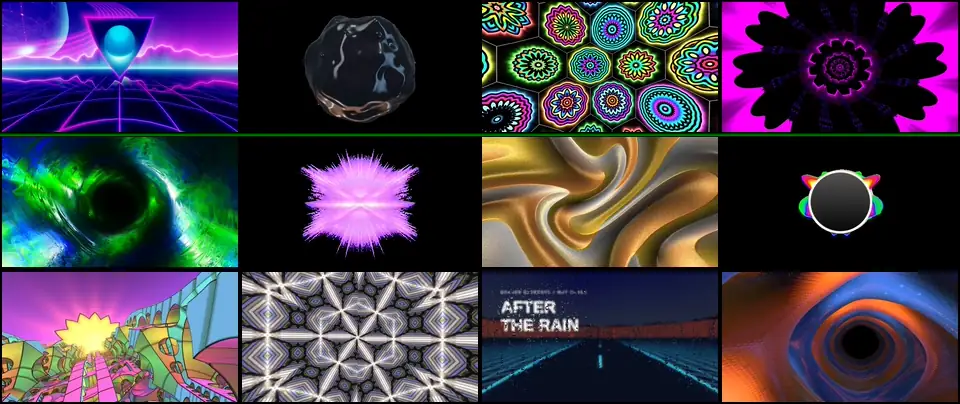

# Banger Elements

Audio-reactive visualizers, shaders and effects for [Remotion](https://remotion.dev), from the makers of [banger.show](https://banger.show).

Each element is one TSX file. You preview it on the site, change its settings, and then send it to Remotion Studio or download it. Your project gets the source file, not a package to install and keep updated.



## The collection

The collection has 33 elements in three groups:

- [Visualizers](https://banger-elements.dev/visualizers) (8) draw audio as waveforms, spectra, rings, fluid and particles.
- [Shaders](https://banger-elements.dev/shaders) (22) are full-frame procedural backgrounds that follow the track, such as Trip, Synthwave, Rain and Matrix.
- [Effects](https://banger-elements.dev/effects) (3) wrap other content. VHS adds analog tape texture, Fisheye adds lens distortion, and Wet Glass puts the frame behind a rainy window.

The [examples page](https://banger-elements.dev/examples) has four finished compositions built only from the collection: an audiogram, a release teaser, a vertical loop and a stream background. Each one shows the code that rendered it.

## Getting started

1. Open your Remotion project in Studio.
2. Pick an element on the [site](https://banger-elements.dev) and adjust its preview settings.
3. Click Install in Studio and confirm the request in Studio. The installed file uses your preview settings as its defaults. You can also download the TSX.
4. Pass your audio to a visualizer or shader, or move your existing layers inside an effect.

To get the whole collection in Studio's Browse Elements panel, use Add Library to Studio and restart Studio, or run `npx remotion elements add-library https://banger-elements.dev` (Remotion 4.0.547 or later).

You can also install an element from its page URL with `npx remotion elements use https://banger-elements.dev/halo`.

Shaders fill whatever composition you place them in, including vertical and square ones. Visualizers and effects draw in a 1280×720 box that you can resize with `width` and `height`.

For coding agents, [llms.txt](https://banger-elements.dev/llms.txt) indexes the collection, and every page has a Markdown version at its URL plus `.md`, such as [halo.md](https://banger-elements.dev/halo.md).

Elements need Remotion 4.0.536 or later. Downloaded files import only React, `remotion`, `@remotion/media` and `@remotion/media-utils`. WebGL elements may need `--gl=angle` when you render, or `--gl=swangle` on a machine without a GPU. The [getting started guide](apps/site/src/content/docs/getting-started.mdx) covers audio setup, timing, effects and rendering.

## Run locally

You need Node.js 24.22.3 and Bun 1.3.8.

```bash
bun install
bun run dev
```

This serves the site at [localhost:3300](http://localhost:3300) and starts Remotion Studio.

## Development

- `packages/elements` has the element source and the collection build.
- `apps/site` is the Astro site with the showcase, examples and docs. Its [README](apps/site/README.md) explains the home page scenes and the "Wrap anything" demos.
- `apps/studio` has the Remotion compositions used for smoke tests and renders.

`bun run check` runs the format check, lint, type checks and tests. `bun run smoke` renders each Studio fixture to `out/`.

## License

[MIT](LICENSE) © 2026 Noice Tech. Remotion and other dependencies have their own licenses.
